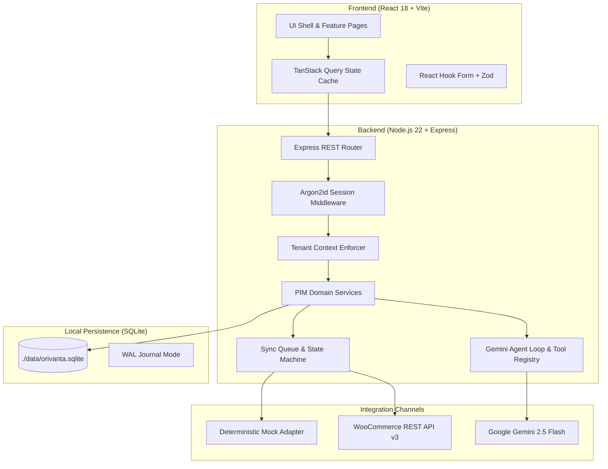

# Orivanta PIM

> **A modern, offline-first Product Information Management platform integrated with WooCommerce, backed by local SQLite persistence and powered by server-side Gemini Agentic AI.**

---

## Table of Contents
1. [Overview & Value Proposition](#1-overview--value-proposition)
2. [Key Highlights](#2-key-highlights)
3. [System Architecture](#3-system-architecture)
4. [Technology Stack](#4-technology-stack)
5. [Visual Identity & Design Engineering](#5-visual-identity--design-engineering)
6. [Prerequisites & Local Setup](#6-prerequisites--local-setup)
7. [Environment Configuration](#7-environment-configuration)
8. [Demo Accounts & Local Persistence](#8-demo-accounts--local-persistence)
9. [WooCommerce Integration & Mock Mode](#9-woocommerce-integration--mock-mode)
10. [Gemini-Powered Agentic AI](#10-gemini-powered-agentic-ai)
11. [Security Model & Application-Layer Multi-Tenancy](#11-security-model--application-layer-multi-tenancy)
12. [Testing Strategy & Test Results](#12-testing-strategy--test-results)
13. [Project Structure](#13-project-structure)
14. [Architecture Decision Records (ADRs)](#14-architecture-decision-records-adrs)
15. [Documentation Suite](#15-documentation-suite)
16. [Screenshot Capture Checklist](#16-screenshot-capture-checklist)
17. [Troubleshooting](#17-troubleshooting)

---

## 1. Overview & Value Proposition

Retailers and product manufacturers frequently struggle with fragmented product data across spreadsheets, ERPs, and digital storefronts. Outdated specifications, missing images, and inconsistent variant matrices lead to failed synchronisations and customer returns.

**Orivanta PIM** provides a single authoritative source of truth for complex product catalogues. It enables merchants to define flexible, dynamic attribute models, manage variable product matrices, audit product completeness, and synchronise verified catalogue data idempotently to WooCommerce stores.

Designed for ₹0-budget hackathon evaluations and developer onboarding, Orivanta runs completely offline using a local SQLite database, operates in a deterministic mock WooCommerce mode by default, and features a bounded Gemini-powered AI assistant that functions with or without an external API key.

---

## 2. Key Highlights

- **Dynamic Attribute Engine**: Define typed attributes (`text`, `number`, `boolean`, `select`, `multiselect`, `date`) with custom validation rules and variant eligibility.
- **Product & Variant Matrix**: Manage Simple and Variable products with multi-attribute variant combinations (e.g., Size + Color) and price overrides.
- **Idempotent WooCommerce Synchronisation**: Pre-sync validation, explicit state machine transitions (`not_synced` -> `pending` -> `syncing` -> `synced` / `failed`), and external ID tracking that prevents duplicate product creation.
- **Deterministic Mock Store**: Full zero-dependency local simulation of WooCommerce REST API v3, including connection tests, simulated failures, and retry workflows.
- **Gemini-Powered Agentic AI**: Server-side bounded tool loop (`AI_MAX_TOOL_STEPS=6`) executing read-only tools to audit completeness, draft enrichments with field-level diffs, and diagnose channel errors.
- **Human Approval Boundary**: AI is strictly advisory; committing changes to the database requires explicit operator confirmation in the UI.
- **Application-Layer Tenant Isolation**: Context-enforced repository scoping ensuring complete data segregation between workspaces without relying on database-level RLS.
- **Warm Editorial Aesthetic**: Distinctive **Terracotta & Warm Ivory** palette (strictly non-blue and non-green) applying **Emil Kowalski's design-engineering principles**.

---

## 3. System Architecture



---

## 4. Technology Stack

### Frontend
- **Framework**: React 18 with TypeScript and Vite 6.
- **Routing**: React Router DOM v7 with protected route guards.
- **State & Caching**: TanStack Query v5 with optimistic updates and live job polling.
- **Styling**: Tailwind CSS v3 with custom Terracotta & Warm Ivory design tokens.
- **Icons**: Lucide React.
- **Validation**: Zod with React Hook Form resolvers.

### Backend
- **Runtime**: Node.js v22 (LTS) with TypeScript.
- **HTTP Server**: Express v4 with `cookie-parser`, `cors`, and `helmet`.
- **Database**: SQLite via `better-sqlite3` and `drizzle-orm` in WAL mode.
- **Authentication**: Argon2id password hashing (`@node-rs/argon2`) with persisted SQLite sessions.
- **Validation**: Zod request schema validation.
- **AI Reasoning**: Google Gen AI SDK (`@google/genai`) with `gemini-2.5-flash` and `MockGeminiProvider`.

---

## 5. Visual Identity & Design Engineering

Orivanta PIM strictly avoids standard blue/green templates, opting for a warm editorial B2B palette:
- **Surfaces**: Warm Ivory (`#FAF8F6`), Card Background (`#FFFFFF`), Muted Slate (`#F4F0EB`).
- **Typography**: Dark Ink (`#181615`), Secondary Ink (`#5E5955`), Muted (`#8A847E`).
- **Accent**: Rich Terracotta (`#C85A32`), Hover (`#B54D28`), Active (`#9E3F1D`).
- **Status Badges**: High-contrast stone neutrals with descriptive text (never relying on color alone).

### Emil Kowalski Design Engineering Principles Applied
1. **Responsive Active Press**: Buttons scale to `scale(0.97)` on `:active` with `140ms ease-out` for tactile feedback.
2. **Never Animate from scale(0)**: Dialogs and drawers enter from `scale(0.96)` with opacity for natural physical presence.
3. **Sub-300ms Durations**: Interactive animations stay strictly under 250ms with custom cubic-bezier curves (`cubic-bezier(0.23, 1, 0.32, 1)`).
4. **Zero Animation on Frequent Actions**: Keyboard navigation, table filters, and pagination transition instantly without sluggish delays.
5. **Origin-Aware Triggers**: Modals and popovers enter relative to viewport focus.

---

## 6. Prerequisites & Local Setup

### Prerequisites
- **Node.js**: v20 or higher (Tested on Node v22.18.0)
- **npm**: v10 or higher
- **Git**: v2.40 or higher
- *No local PHP, MySQL, or Docker required.*

### Step 1: Install Dependencies
```bash
npm install
```

### Step 2: Initialize Database
```bash
# Run DDL schema migrations
npm run db:migrate

# Populate with demo catalogue, attributes, variants, and sync history
npm run db:seed
```

### Step 3: Run the Platform
#### On Windows (One-Click Launcher):
Double-click `run.bat` or run:
```cmd
run.bat
```

#### On POSIX Shell (Linux / macOS):
```bash
# Terminal 1: Backend API (Port 5000)
npm run dev:backend

# Terminal 2: Frontend UI (Port 3000)
npm run dev:frontend
```

Open your browser to: **`http://localhost:3000`**

---

## 7. Environment Configuration

Copy the root template to create your local `.env`:
```bash
cp .env.example .env
```

| Variable | Required | Default | Secret | Purpose |
| :--- | :--- | :--- | :--- | :--- |
| `NODE_ENV` | Yes | `development` | No | Application environment. |
| `PORT` | Yes | `5000` | No | Backend Express API port. |
| `DATABASE_PATH` | Yes | `./data/orivanta.sqlite` | No | Local SQLite database file path. |
| `SESSION_SECRET` | Yes | (32+ chars) | **Yes** | Server session signing secret. |
| `COOKIE_SECURE` | No | `false` | No | Set to `true` in production with HTTPS. |
| `INTEGRATION_MODE` | Yes | `mock` | No | `'mock'` for local evaluation, `'woocommerce'` for live store. |
| `WOOCOMMERCE_STORE_URL` | No | `https://mock.orivanta.local` | No | Target WooCommerce store URL. |
| `WOOCOMMERCE_CONSUMER_KEY` | No | (empty) | No | WooCommerce REST API Consumer Key. |
| `WOOCOMMERCE_CONSUMER_SECRET`| No | (empty) | **Yes** | WooCommerce REST API Consumer Secret. |
| `AI_ENABLED` | Yes | `false` | No | Set to `true` to enable live Gemini API calls. |
| `GEMINI_API_KEY` | No | (empty) | **Yes** | Google Gemini API key. |
| `GEMINI_MODEL` | Yes | `gemini-2.5-flash` | No | Gemini model identifier. |
| `AI_MAX_TOOL_STEPS` | Yes | `6` | No | Maximum tool execution turns per agent task. |
| `AI_REQUEST_TIMEOUT_MS` | Yes | `30000` | No | Agent execution timeout in milliseconds. |

> [!IMPORTANT]
> The frontend bundle contains zero secrets. `VITE_API_BASE_URL` is configured via Vite proxy (`/api -> http://localhost:5000`).

---

## 8. Demo Accounts & Local Persistence

The database seed initializes two isolated workspaces to demonstrate multi-tenancy:

| User Account | Password | Workspace | Tenant Role |
| :--- | :--- | :--- | :--- |
| `demo@orivanta.local` | `OrivantaDemo2026!` | `ws_default` (Orivanta Demo Workspace) | Owner |
| `other@tenant2.local` | `OrivantaDemo2026!` | `ws_isolated` (Isolated Workspace B) | Owner |

### SQLite Persistence & Reset
- Database is stored locally at `./data/orivanta.sqlite`.
- Persists across restarts without hosted database accounts.
- To safely reset the catalogue and reload sample data:
  ```bash
  npm run db:reset
  ```

---

## 9. WooCommerce Integration & Mock Mode

Orivanta PIM supports two explicit integration modes:
1. **Mock Mode (`INTEGRATION_MODE=mock`)**: Default out-of-the-box mode. Executes all application workflows, validation checks, and sync job states deterministically without external credentials.
2. **Live WooCommerce Mode (`INTEGRATION_MODE=woocommerce`)**: Connects to an external WooCommerce store via REST API v3 using HTTPS Basic Authentication.

### Live Store Configuration
1. Open your WordPress admin: **WooCommerce > Settings > Advanced > REST API > Add Key**.
2. Assign **Read/Write** permissions.
3. Update `.env`:
   ```dotenv
   INTEGRATION_MODE=woocommerce
   WOOCOMMERCE_STORE_URL=https://your-store.example.com
   WOOCOMMERCE_CONSUMER_KEY=ck_your_key_here
   WOOCOMMERCE_CONSUMER_SECRET=cs_your_secret_here
   ```

---

## 10. Gemini-Powered Agentic AI

The AI assistant operates via a **server-controlled bounded tool loop** with zero autonomous mutation tools.

### 4 Mandatory Workflows Supported
1. **Product Completeness Audit**: Inspects products using `get_product`, `get_attribute_definitions`, and `validate_product`. Returns a prioritised audit checklist with actionable findings.
2. **AI-Assisted Enrichment**: Takes raw operator notes and drafts formatted titles, short descriptions, and compliant attributes. Displays a field-level diff preview with checkable approvals.
3. **Sync Readiness & Failure Diagnosis**: Analyzes previous failed sync jobs and validation reports, explaining the issue in clear terms and suggesting safe remediations.
4. **Natural Language Catalogue Query**: Answers inventory questions (e.g., "Which products are in draft status?") by querying real database records via `search_products`.

### Offline Fallback Capability
When `AI_ENABLED=false` or `GEMINI_API_KEY` is not provided, the platform transparently uses the built-in `MockGeminiProvider`. Evaluators can test all 4 agentic workflows, inspect execution traces, and review diffs without incurring API costs.

---

## 11. Security Model & Application-Layer Multi-Tenancy

### The SQLite RLS Constraint
SQLite does not provide PostgreSQL-style Row Level Security (RLS). Orivanta PIM compensates for this by enforcing tenant isolation rigorously in the **Application Layer**:
- The session middleware injects an authenticated `WorkspaceContext` into every request.
- All repository queries explicitly append `and(eq(table.id, id), eq(table.workspaceId, ctx.workspaceId))`.
- Out-of-scope record queries return `404 Not Found` without disclosing existence.
- Verified by negative authorization tests in `backend/tests/pim.test.ts`.

---

## 12. Testing Strategy & Test Results

The automated test suite runs via **Vitest** and **Supertest** without external credentials or network requests.

### Latest Test Results (Verified)
```text
 ✓ tests/pim.test.ts (16 tests) 1235ms
   ✓ 1. Authentication & Tenant Isolation (Application Layer) > rejects unauthenticated requests to protected routes
   ✓ 1. Authentication & Tenant Isolation (Application Layer) > rejects cross-tenant access to another workspace products
   ✓ 1. Authentication & Tenant Isolation (Application Layer) > rejects cross-tenant header spoofing when user is not a member
   ✓ 2. Dynamic Attribute Engine & Schema Validation > lists workspace dynamic attribute definitions
   ✓ 2. Dynamic Attribute Engine & Schema Validation > creates a custom attribute definition and enforces unique code within workspace
   ✓ 3. Product Catalogue Management > creates a new simple product with dynamic attributes and categories
   ✓ 3. Product Catalogue Management > enforces SKU uniqueness within workspace
   ✓ 3. Product Catalogue Management > duplicates a product with a unique copy SKU and not_synced status
   ✓ 4. Product Variants & Matrix > creates variants and prevents duplicate attribute combinations
   ✓ 5. WooCommerce Integration & Idempotent Synchronization > tests connection in mock mode successfully
   ✓ 5. WooCommerce Integration & Idempotent Synchronization > synchronizes a validated product to WooCommerce mock store
   ✓ 5. WooCommerce Integration & Idempotent Synchronization > blocks synchronisation when mandatory validation fails
   ✓ 5. WooCommerce Integration & Idempotent Synchronization > simulates a sync failure and successfully retries idempotently
   ✓ 6. Gemini Agentic AI Assistant & Tool Registry > executes server-controlled agent tools with Zod validation
   ✓ 6. Gemini Agentic AI Assistant & Tool Registry > runs product completeness audit with structured checklist and tool traces
   ✓ 6. Gemini Agentic AI Assistant & Tool Registry > drafts product enrichment proposal with field diff without mutating DB

 Test Files  1 passed (1)
      Tests  16 passed (16)
```

Run tests with:
```bash
npm test
```

---

## 13. Project Structure

```text
orivanta-pim/
├── frontend/
│   ├── src/
│   │   ├── api/client.ts              # API fetch wrapper with cookie handling
│   │   ├── components/
│   │   │   ├── layout/AppLayout.tsx   # Dashboard shell & sidebar
│   │   │   └── ui/                    # Button, Badge, Card, Modal primitives
│   │   ├── context/AuthContext.tsx    # Authentication provider & workspace switcher
│   │   ├── pages/                     # Feature pages (Overview, Products, Editor, etc.)
│   │   ├── App.tsx                    # Route definitions
│   │   ├── main.tsx                   # React 18 bootstrap
│   │   └── index.css                  # Emil Kowalski easing & active press rules
│   ├── package.json
│   ├── tsconfig.json
│   └── vite.config.ts
├── backend/
│   ├── src/
│   │   ├── db/                        # schema.ts, index.ts, migrate.ts, seed.ts
│   │   ├── integrations/woocommerce/  # woo-client, woo-mock-adapter, woo-mapper
│   │   ├── middleware/                # auth.ts, tenant.ts, logger.ts, error-handler.ts
│   │   ├── modules/
│   │   │   ├── ai/                    # agent-tools.ts, gemini-client.ts, ai.controller.ts
│   │   │   ├── attributes/            # attribute.repository.ts, attribute.service.ts
│   │   │   ├── categories/            # category.repository.ts, category.controller.ts
│   │   │   ├── products/              # product.repository.ts, product.service.ts
│   │   │   ├── sync/                  # sync.service.ts, sync.controller.ts
│   │   │   └── variants/              # variant.repository.ts, variant.controller.ts
│   │   ├── routes.ts                  # REST API routes
│   │   ├── app.ts                     # Express application configuration
│   │   └── index.ts                   # Server entrypoint
│   ├── tests/pim.test.ts              # Automated Vitest test suite
│   ├── package.json
│   └── tsconfig.json
├── data/                              # Local SQLite storage (ignored by git)
│   └── orivanta.sqlite
├── docs/
│   ├── adr/                           # 9 Architecture Decision Records (0001 - 0009)
│   ├── PRODUCT_REQUIREMENTS.md
│   ├── ARCHITECTURE.md
│   ├── DATA_MODEL.md
│   ├── INTEGRATION.md
│   ├── DEVELOPMENT.md
│   ├── SECURITY.md
│   ├── DEMO_SCRIPT.md
│   └── AI_AGENT_DEMO.md
├── run.bat                            # Windows one-click launcher
├── .env.example                       # Root environment template
├── .gitignore
├── package.json                       # Monorepo workspace configuration
└── README.md                          # Master deliverable
```

---

## 14. Architecture Decision Records (ADRs)

| ADR ID | Decision Title | Status |
| :--- | :--- | :--- |
| [0001](file:///d:/MyFiles/Kilowatt-Repo/docs/adr/0001-use-react-and-express.md) | Use React and Express in a Monorepo | Accepted |
| [0002](file:///d:/MyFiles/Kilowatt-Repo/docs/adr/0002-use-sqlite-for-local-persistence.md) | Use SQLite for Local Persistence | Accepted |
| [0003](file:///d:/MyFiles/Kilowatt-Repo/docs/adr/0003-isolate-woocommerce-integration.md) | Isolate WooCommerce Integration Behind Adapter | Accepted |
| [0004](file:///d:/MyFiles/Kilowatt-Repo/docs/adr/0004-use-a-mock-integration-mode.md) | Use a Deterministic Mock Integration Mode | Accepted |
| [0005](file:///d:/MyFiles/Kilowatt-Repo/docs/adr/0005-enforce-tenant-isolation-in-the-application-layer.md) | Enforce Tenant Isolation in the Application Layer | Accepted |
| [0006](file:///d:/MyFiles/Kilowatt-Repo/docs/adr/0006-model-flexible-product-attributes.md) | Model Flexible Product Attributes via Hybrid Relational + JSON | Accepted |
| [0007](file:///d:/MyFiles/Kilowatt-Repo/docs/adr/0007-design-idempotent-product-synchronisation.md) | Design Idempotent Product Synchronisation | Accepted |
| [0008](file:///d:/MyFiles/Kilowatt-Repo/docs/adr/0008-use-gemini-for-bounded-agentic-ai.md) | Use Gemini for Bounded Agentic AI | Accepted |
| [0009](file:///d:/MyFiles/Kilowatt-Repo/docs/adr/0009-require-human-approval-for-ai-proposed-mutations.md) | Require Human Approval for AI-Proposed Mutations | Accepted |

---

## 15. Documentation Suite

- [`docs/PRODUCT_REQUIREMENTS.md`](file:///d:/MyFiles/Kilowatt-Repo/docs/PRODUCT_REQUIREMENTS.md) — Comprehensive product requirements specification.
- [`docs/ARCHITECTURE.md`](file:///d:/MyFiles/Kilowatt-Repo/docs/ARCHITECTURE.md) — Component interactions, data flow, and sequence diagrams.
- [`docs/DATA_MODEL.md`](file:///d:/MyFiles/Kilowatt-Repo/docs/DATA_MODEL.md) — Relational schema definitions and JSON payload specifications.
- [`docs/INTEGRATION.md`](file:///d:/MyFiles/Kilowatt-Repo/docs/INTEGRATION.md) — WooCommerce REST API v3 mapping and mock mode contract.
- [`docs/DEVELOPMENT.md`](file:///d:/MyFiles/Kilowatt-Repo/docs/DEVELOPMENT.md) — Local development, migrations, and operations guide.
- [`docs/SECURITY.md`](file:///d:/MyFiles/Kilowatt-Repo/docs/SECURITY.md) — Application-layer tenant isolation and secret redaction.
- [`docs/DEMO_SCRIPT.md`](file:///d:/MyFiles/Kilowatt-Repo/docs/DEMO_SCRIPT.md) — Step-by-step hackathon presentation script.
- [`docs/AI_AGENT_DEMO.md`](file:///d:/MyFiles/Kilowatt-Repo/docs/AI_AGENT_DEMO.md) — Reproducible walkthrough of the 4 agentic AI workflows.

---

## 16. Screenshot Capture Checklist

When deploying to GitHub, capture screenshots of the following live screens:
- [ ] **Overview Dashboard**: Displaying product metrics, recent updates, and recent sync activity.
- [ ] **Product Catalogue**: Showing search, faceted filters, and the catalogue table.
- [ ] **Product Editor (Dynamic Attributes)**: Showing dynamic attribute form inputs rendered from definitions.
- [ ] **Variant Matrix**: Showing multi-attribute variant combinations for variable products.
- [ ] **AI Completeness Audit**: Showing the prioritised audit checklist and tool execution trace modal.
- [ ] **AI-Assisted Enrichment**: Showing the field-level diff preview with checkable approvals.
- [ ] **Sync Center**: Showing real-time job monitoring, external IDs, and retry actions.

---

## 17. Troubleshooting

### Port 5000 or 3000 in use
If port 5000 is occupied, set `PORT=5001` in `.env` and update the proxy target in `frontend/vite.config.ts`.

### Database Reset
To restore sample catalogue items and start fresh:
```bash
npm run db:reset
```

### Live WooCommerce Connection Errors
- Verify that your WordPress site supports HTTPS. Plain HTTP is rejected for remote hosts to protect credentials.
- Verify that the REST API key has both **Read and Write** permissions.
