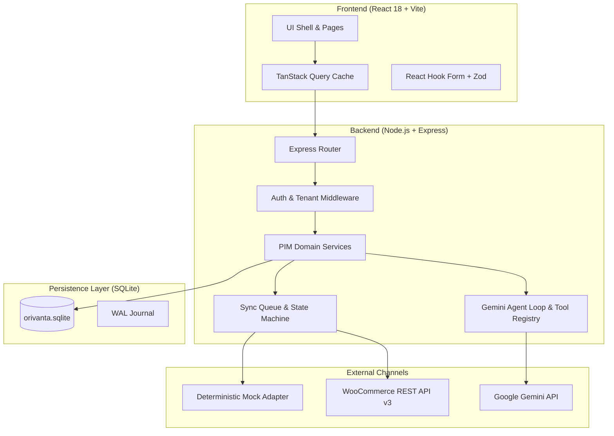
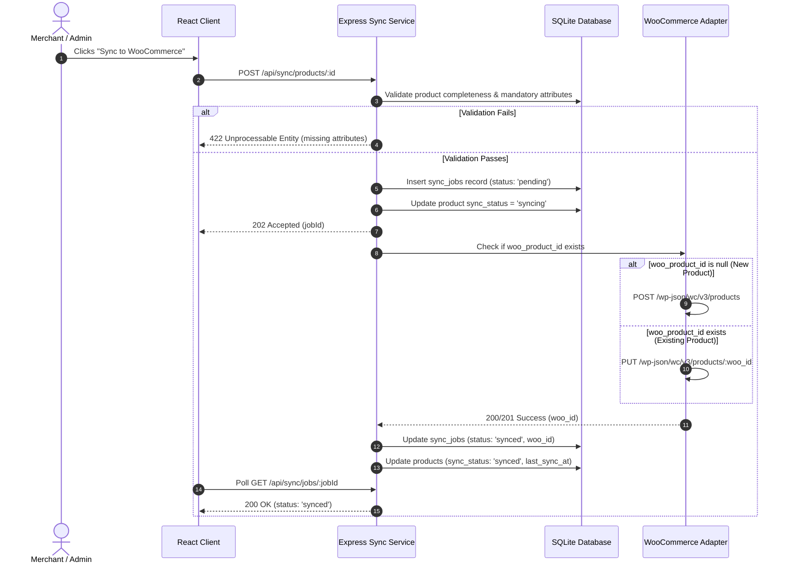
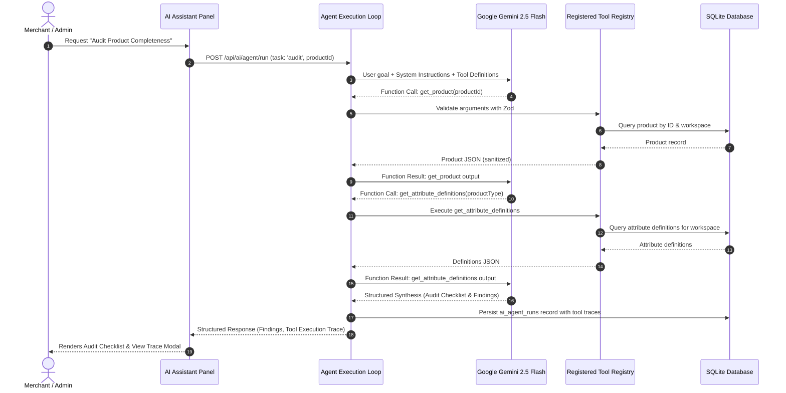

# System Architecture — Orivanta PIM

## 1. High-Level Architecture Overview

Orivanta PIM follows a decoupled, layered full-stack TypeScript architecture with zero external database dependencies.

---

## 2. Component Layers

### 2.1 Presentation Layer (Frontend)
- **Framework**: React 18, TypeScript, Vite.
- **Routing**: React Router DOM with protected route guards.
- **State Management**: TanStack Query for remote state caching, optimistic updates, and background sync job polling.
- **Styling**: Tailwind CSS with custom **Terracotta & Warm Ivory** tokens.
- **Design Engineering**: Emil Kowalski principles — active press scale(0.97), entering scale(0.95)+opacity, custom ease-out transitions (`cubic-bezier(0.23, 1, 0.32, 1)`), origin-aware popovers, and no animations on keyboard-heavy actions.

### 2.2 API & Application Layer (Backend)
- **Framework**: Express on Node.js 22.
- **Security Middleware**: `helmet`, `cookie-parser`, strict CORS, secret masking in logs, request ID generation.
- **Tenant Context**: `tenant.ts` middleware verifies session validity and workspace membership, creating an immutable `req.workspaceCtx`.
- **Validation**: Strict Zod schemas on all incoming request bodies and query parameters.

### 2.3 Domain Services & Repositories
- **Context-Enforced Repositories**: Every database query injects `and(eq(table.workspaceId, ctx.workspaceId), ...)`.
- **Product Service**: Enforces SKU uniqueness, category validation, and dynamic attribute schema conformance.
- **Sync Engine**: Manages asynchronous sync jobs, state transitions (`not_synced` -> `pending` -> `syncing` -> `synced` / `failed`), and idempotent retry loops.

### 2.4 WooCommerce Integration Layer
- **Adapter Interface**: Defined by `WooAdapterInterface`.
- **Mock Adapter**: Emulates WooCommerce REST v3 endpoints with deterministic in-memory/SQLite state for offline demonstrations.
- **Live Client**: Connects via HTTPS to WooCommerce REST v3 with request timeouts, HTTP error translation, and secret redaction.
- **Bidirectional Mapper**: Maps between PIM product representations and WooCommerce product/variation payloads.

### 2.5 Gemini Agentic AI Service
- **SDK**: Official `@google/genai` client.
- **Bounded Tool Loop**: Server-side loop calling up to `AI_MAX_TOOL_STEPS=6` registered tools.
- **Safety Boundary**: Zero mutation tools in the registry. Output produces structured diffs and audits. Committing changes requires an independent, authenticated human request in the UI.
- **Mock Provider**: `MockGeminiProvider` executes full agent loops offline for automated Vitest suites and zero-key local runs.

---

## 3. Data Flow Diagrams

### 3.1 Product Synchronization Workflow

### 3.2 Gemini Agentic Completeness Audit Workflow

